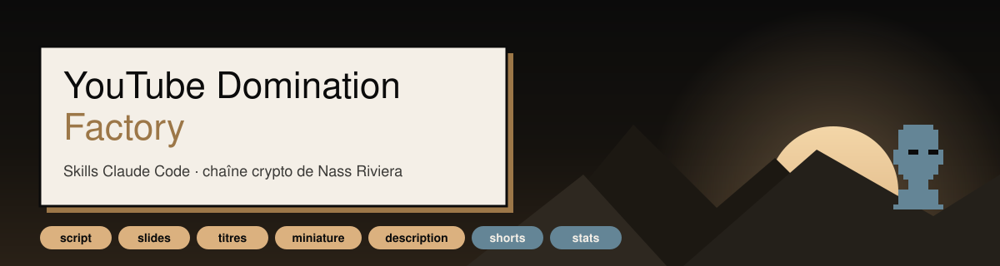

<p align="center">
  
</p>

<p align="center">
  <a href="https://www.youtube.com/@NassinCrypto"></a>
  
  
  
  
</p>

<h3 align="center">Une phrase en entrée. Une vidéo prête à tourner en sortie.</h3>

<p align="center">
  Douze skills Claude Code qui fabriquent les vidéos de la chaîne crypto de <a href="https://nassriviera.com">Nass Riviera</a> :<br>
  recherche, script, slides animées, titres, miniature, description, Shorts, thread X, post LinkedIn, stats.<br>
  Nass valide aux étapes clés. Le reste se fait tout seul.
</p>

---

## Sommaire

- [La ligne éditoriale](#la-ligne-éditoriale)
- [Ce que la factory produit](#ce-que-la-factory-produit)
- [Le pipeline](#le-pipeline)
- [Les skills](#les-skills)
- [Déjà en ligne](#déjà-en-ligne)
- [Le cadre, source unique](#le-cadre-source-unique)
- [Installation](#installation)
- [Le code](#le-code)
- [Structure du dépôt](#structure-du-dépôt)
- [Où on en est](#où-on-en-est)

---

## La ligne éditoriale

La chaîne est **100 % crypto**. Trois idées, toujours les mêmes, dans chaque vidéo :

| | Idée | Ce que ça veut dire à l'écran |
|---|---|---|
| **1** | **Acheter en dehors des échanges** | On achète on-chain, avant qu'une crypto soit connue de tous. |
| **2** | **Acheter les bons coins** | Savoir les reconnaître, c'est le vrai sujet de la chaîne. |
| **3** | **Pas tous les jours** | Des achats rares et réfléchis. Pas de trading, pas d'agitation, pas de FOMO. |

Le public : des hommes de 25 à 40 ans, déjà investisseurs (surtout en immobilier), qui n'ont pas encore touché à la crypto. On part de ce qu'ils connaissent pour expliquer ce qu'ils ne connaissent pas. Chaque terme technique est expliqué la première fois.

Règles de fond, appliquées en silence : spot uniquement, zéro levier, zéro crédit, zéro jeu d'argent, zéro chiffre inventé. Un seul rappel visible, une fois par contenu : *« Pas un conseil en investissement. »*

---

## Ce que la factory produit

Tu parles à Claude Code en français. Le bon skill se déclenche.

| Tu dis… | Il se passe… | Tu obtiens… |
|---|---|---|
| « Fais une vidéo sur comment acheter sa première crypto hors échange » | le pipeline complet, avec tes validations | script, slides, 7 titres, miniature, description, Shorts, thread X, post LinkedIn |
| « Trouve-moi des idées de vidéo » | veille crypto scorée | 3 à 5 idées, une recommandation |
| « Écris le script sur … » puis « …slide d'après… » | écriture section par section, en dictée | `slug.md` + deck HTML animé, synchronisés |
| « Trouve un titre » | SEO + clic | 7 titres, mot-clé principal et secondaires |
| « Crée la miniature » | 3 concepts notés, image de fond générée | brief Canva + fichiers 1280×720 et aperçu 256 px |
| « Écris la description » | hook, timestamps, offres, liens réels | description + tags |
| « Découpe la vidéo en shorts » | repurposing de la vidéo longue | Shorts, thread X @punk6995, post LinkedIn |
| « Écris un short sur … » puis « monte le short » | Short natif, puis composition HyperFrames | MP4 vertical 1080×1920 sous-titré |
| « Analyse mes stats » | lecture de YouTube Studio ou de l'API | rapport HTML, tableau de bord, recommandations |

---

## Le pipeline

Une vidéo complète passe par neuf phases. Les phases avec Nass se jouent dans la conversation principale ; les autres sont confiées à des agents.

```mermaid
flowchart LR
    classDef nass fill:#F4EFE7,stroke:#0B0B0B,stroke-width:2px,color:#0B0B0B
    classDef agent fill:#648596,stroke:#0B0B0B,stroke-width:2px,color:#F4EFE7
    classDef out fill:#DBB17F,stroke:#0B0B0B,stroke-width:2px,color:#0B0B0B

    A["0 · Init<br/>slug, funnel, contexte"]:::nass --> B["0.5 · yt-veille<br/>Nass choisit l'idée"]:::nass
    B --> C["0.75 · yt-transcript<br/>brief de recherche"]:::agent
    C --> D["1 · yt-script<br/>script + slides, avec Nass"]:::nass
    D --> E["2a · yt-titres-seo<br/>titre gagnant"]:::agent
    E --> F["2b · yt-miniature"]:::agent
    E --> G["2c · yt-description"]:::agent
    F --> H["3 · Validation<br/>titre · miniature · description"]:::nass
    G --> H
    H --> I["4 · yt-repurposing<br/>Shorts · X · LinkedIn"]:::agent
    I --> J["5 · Récap, archive,<br/>mémoire des choix"]:::out
```



Tout passe par un seul fichier, `context/video-context.json`, dont le contrat est écrit dans [`context/SCHEMA.md`](context/SCHEMA.md). Les agents lisent ce fichier et déposent leur section dans `context/runs/<slug>/`. Un seul écrivain fusionne : l'orchestrateur. Une vidéo terminée part dans `context/archive/`, avec son ID YouTube à la publication. C'est ce lien qui permet ensuite de rattacher les statistiques aux choix de titre, de miniature et de script.

---

## Les skills

| Skill | Rôle | Sorties |
|---|---|---|
| [`yt-orchestrator`](yt-orchestrator/SKILL.md) | Pilote le pipeline, tient le contexte, reprend là où ça s'est arrêté | `context/video-context.json`, archive |
| [`yt-veille`](yt-veille/SKILL.md) | Idées de vidéos scorées (veille automatique en pause) | 3 à 5 idées, recommandation |
| [`yt-transcript`](yt-transcript/SKILL.md) | Recherche concurrentielle : faits sourcés, angles couverts et manquants | brief de recherche |
| [`yt-script`](yt-script/SKILL.md) | Script avec Nass, slides HTML animées, mode dictée « slide après » | `yt-script/outputs/<slug>.md` + `-visual.html` |
| [`yt-titres-seo`](yt-titres-seo/SKILL.md) | 7 titres, mot-clé principal et secondaires | titre gagnant |
| [`yt-miniature`](yt-miniature/SKILL.md) | 3 concepts notés, génération d'image, montage PIL | brief + JPG 1280×720 |
| [`yt-description`](yt-description/SKILL.md) | Hook, timestamps, offres, liens, tags | description complète |
| [`yt-repurposing`](yt-repurposing/SKILL.md) | Découpe d'une vidéo longue | Shorts, thread X, post LinkedIn |
| [`yt-shorts-script`](yt-shorts-script/SKILL.md) | Shorts natifs 30 à 60 s, en série | scripts de Shorts |
| [`yt-shorts-montage`](yt-shorts-montage/SKILL.md) | Composition HyperFrames, sous-titres, SFX, rendu | MP4 1080×1920 |
| [`yt-analytics`](yt-analytics/SKILL.md) | Stats par vidéo et par chaîne, deux périodes jamais mélangées | rapports et tableau de bord HTML |
| [`yt-calendrier`](yt-calendrier/SKILL.md) | Calendrier éditorial et pipeline de production | planning |

Chaque skill marche aussi seul, appelé directement. Les détails lourds vivent dans `references/`, chargés à la demande. Les choix passés et leurs résultats vivent dans `memory/`.

---

## Déjà en ligne

La formation offerte, trois vidéos produites avec la factory et publiées en octobre 2026 ([playlist](https://youtube.com/playlist?list=PLH8HsDRAJ7R8)) :

<table>
  <tr>
    <td align="center" width="33%">
      <a href="https://www.youtube.com/watch?v=njfEJFd7hQ8"></a><br>
      <b>Pourquoi il faut investir en 2026 ?</b><br><sub>5 octobre · 9 min 29</sub>
    </td>
    <td align="center" width="33%">
      <a href="https://www.youtube.com/watch?v=FVajDtrHsPU"></a><br>
      <b>Comment devenir riche grâce à l'investissement ?</b><br><sub>7 octobre · 11 min 10</sub>
    </td>
    <td align="center" width="33%">
      <a href="https://www.youtube.com/watch?v=71HX4YUNrNs"></a><br>
      <b>Investis en cryptos avec cette méthode !!</b><br><sub>11 octobre · 10 min</sub>
    </td>
  </tr>
</table>

Pour chacune : script et deck dans `yt-script/outputs/`, miniature finale dans `yt-miniature/outputs/`, fiche avec ID YouTube dans `context/archive/`.

---

## Le cadre, source unique

Tout ce qu'un skill doit savoir sur la chaîne est écrit une seule fois dans [`_shared/cadre-nass.md`](_shared/cadre-nass.md). Les skills y renvoient, aucun ne le recopie. Modifier le cadre, c'est modifier les douze skills d'un coup.

| Section | Contenu |
|---|---|
| Narrative | Les trois idées ci-dessus, et ce qui est abandonné (challenge public, wallet public, vocabulaire de trader) |
| Avatar | Les mots exacts de Nass sur son public, jamais reformulés |
| Offres et CTA | Formation offerte, communauté privée, live Convergence, par étage du funnel |
| Liens | Les vraies URL : chaîne, playlist, Telegram, X, Instagram, Twitch, site. Jamais une URL inventée. |
| Ton | Direct, posé, pédagogique. Jamais hype, jamais corporate. |
| Règles de fond | Spot, zéro levier, zéro crédit, zéro jeu d'argent, chiffres réels et datés |
| Charte slides | Noir `#0B0B0B`, sable/or `#DBB17F`, crème `#F4EFE7`, bleu punk `#648596`, Archivo Black + Public Sans |
| Charte miniatures | Photo réaliste de Nass, texte haut blanc, texte bas orange `#FF6B35`, tons bleus |
| La voix de Nass | Ce qu'il dicte est reproduit tel quel. Ce qu'il n'a pas demandé est proposé, marqué `[PROP]`, jamais imposé. |

---

## Installation

Le dépôt vit à `~/youtube-domination-factory` sur Mac et `C:\Users\User\youtube-domination-factory` sur Windows. Les skills désignent cette racine par `{repo}` et chaque fichier redonne les deux chemins : une session Claude Code lit le bon, quelle que soit la machine.

Les skills sont branchés dans Claude Code par des liens vers le dépôt. Une modification ici est active immédiatement.

**Mac**

```bash
git clone https://github.com/NassBarbossa/youtube-domination-factory.git ~/youtube-domination-factory
cd ~/youtube-domination-factory && git checkout rebrand/crypto
for d in yt-*/; do d=${d%/}; [ -f "$d/SKILL.md" ] && ln -sfn "../../youtube-domination-factory/$d" ~/.claude/skills/"$d"; done
```

**Windows (PowerShell)**

```powershell
git clone https://github.com/NassBarbossa/youtube-domination-factory.git C:\Users\User\youtube-domination-factory
cd C:\Users\User\youtube-domination-factory; git checkout rebrand/crypto
Get-ChildItem . -Directory -Filter 'yt-*' | Where-Object { Test-Path "$($_.FullName)\SKILL.md" } |
  ForEach-Object { New-Item -ItemType Junction -Path "$env:USERPROFILE\.claude\skills\$($_.Name)" -Target $_.FullName }
```

**Hors git, à recréer sur chaque machine**

| Fichier | Sert à | Comment l'obtenir |
|---|---|---|
| `.env` (racine) | `OPENROUTER_API_KEY=…` pour générer les images de miniatures | clé OpenRouter |
| `yt-analytics/client_secret.json` | identifiants OAuth de l'API YouTube | console Google Cloud, application de bureau |
| `yt-analytics/token.json` | jeton OAuth | `python3 yt-analytics/auth.py` |

Outils utiles : Python 3.10+, `uv` (transcripts), Node + Playwright + Chrome (vérification des slides), HyperFrames (Shorts).

---

## Le code

Les skills sont du Markdown. Autour, un peu de Python, local, pour les tâches répétitives.

| Dossier | Scripts | Installer |
|---|---|---|
| `yt-analytics/` | `parse_youtube_csv.py` (export YouTube Studio FR ou EN), `generate_report.py`, `generate_dashboard.py`, `analyze.py` et `feedback_analyzer.py` (API YouTube Analytics), `auth.py` | `pip install -r yt-analytics/requirements.txt` |
| `yt-miniature/scripts/` | `generate.py` (OpenRouter), `composite.py` (incrustation fond vert), `overlay.py` (texte), `banner.py`, `pfp.py`, `check.py` (contrôle 256 px) | `pip install -r yt-miniature/scripts/requirements.txt` |
| `yt-veille/scripts/` | veille automatique, en pause (SQLite sur le VPS, scoring, rapport), 58 tests | `pip install -r yt-veille/scripts/requirements.txt` |
| `yt-transcript/scripts/` | `get_transcript.py` | `uv` (dépendance déclarée dans le script) |

Vérifier que tout tient après une modification :

```bash
git ls-files '*.py' | xargs python3 -m py_compile
cd yt-veille/scripts && python3 -m pytest -q
```

Les statistiques distinguent deux périodes, qui ne sont jamais moyennées ensemble : la période IA, avant le 7 octobre 2026, et la période crypto depuis.

---

## Structure du dépôt

```
_shared/cadre-nass.md            cadre éditorial, source unique
yt-*/SKILL.md                    un skill par dossier
yt-*/references/                 détails chargés à la demande
yt-*/memory/                     choix passés et leçons tirées des stats
yt-*/outputs/                    scripts, decks, miniatures produits
context/video-context.json       contexte du pipeline en cours
context/SCHEMA.md                contrat du contexte
context/archive/                 vidéos terminées, avec ID YouTube
yt-analytics/*.py                stats (local)
yt-miniature/scripts/*.py        montage des miniatures (local)
yt-veille/scripts/               veille automatique (VPS, en pause)
shows/                           assets de l'émission live Convergence
docs/                            specs et plans d'origine, visuels du README
CLAUDE.md                        guide de travail pour Claude Code
TODO.md                          décisions en attente, dette technique
```

---

## Où on en est

- Branche de travail : `rebrand/crypto`, en avance sur `master`, à merger une fois validée.
- Trois vidéos publiées, la prochaine sera la première hors série.
- Veille automatique en pause, sur décision de Nass.
- Le détail des décisions ouvertes et des corrections à faire est dans [`TODO.md`](TODO.md).

<p align="center"><sub>Projet privé de Nass Riviera · construit avec Claude Code</sub></p>
